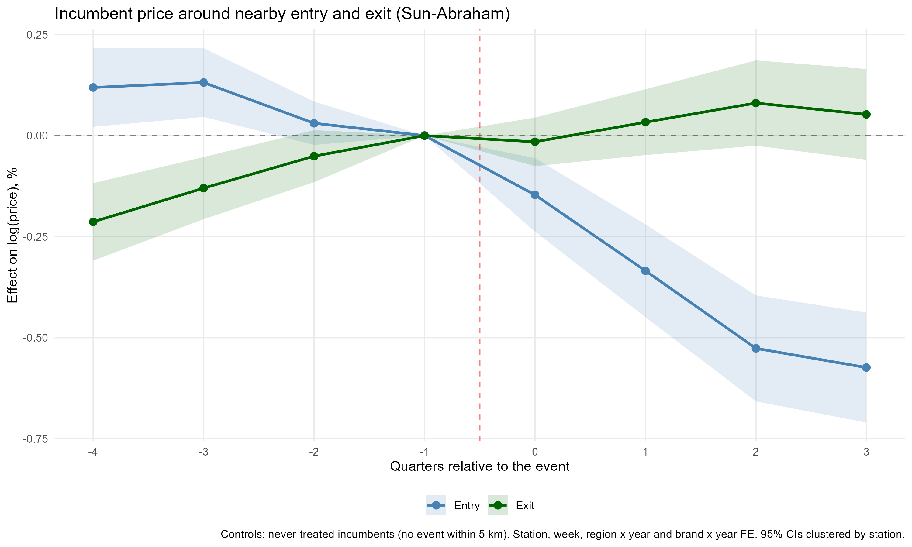

# Spatial Competition and Retail Gasoline Prices in Chile

[Read the paper (PDF, in Spanish)](paper/paper_competencia_espacial.pdf)

Does the entry or exit of a nearby gas station change the prices of incumbent stations? I apply the event-study design of Taylor and Muehlegger (2025) to a station-week panel of retail gasoline prices from Chile's National Energy Commission (CNE): about 973,000 station-weeks from 2,022 stations over 743 weeks (January 2012 to March 2026), built from 9.2 million raw price reports.

Methods: event study · Sun–Abraham estimator with never-treated controls · two-way fixed effects baseline · Rambachan–Roth (HonestDiD) sensitivity to parallel-trends violations · spatial competition measures (Haversine, validated against driving distances) · Conley standard errors

## Main findings

- Entry lowers incumbent prices. With the Sun–Abraham estimator and never-treated incumbents (no entry within 5 km) as controls, the entry of a competitor within 1 km reduces the incumbent's price by about 0.4% over the following year, about 6% of the gross retail margin, close to the ~7% Taylor and Muehlegger (2025) find in California. The effect appears at the entry date and deepens over the first year. It survives Rambachan–Roth violations of parallel trends of up to 0.8 times the largest pre-entry violation, with region-by-year and brand-by-year fixed effects (1.4 without them).
- Exit has no effect at the event date. Incumbent prices do not change after a nearby rival stops operating (average post effect +0.04%, s.e. 0.04). They rise slightly over the year before the exit, consistent with a rival that winds down gradually.
- The comparison group matters. A two-way fixed effects event study that uses already-treated stations as controls makes the entry effect look like a pre-existing trend. Most of that trend disappears with never-treated controls (Goodman-Bacon 2021; Sun and Abraham 2021).
- Common shocks dominate price variation. Week fixed effects account for 98.4% of the variation in log retail prices, so local competition operates on a narrow margin. This is consistent with common wholesale-cost movements and with pricing mechanisms documented in the Chilean literature (Lemus and Luco 2021; Luco 2019).



*Incumbent log price around the entry and exit of a station within 1 km, by quarter relative to the event (reference: the quarter before). Sun–Abraham estimator with never-treated controls; station, week, region-by-year and brand-by-year fixed effects; 95% confidence intervals clustered by station.*

## Reproducing the results

```r
source("run_all.R")
```

This checks dependencies, cleans the data, builds entry and exit events, estimates every model, writes tables and figures to `output/` (README figures to `figures/`) and compiles the paper. Every number in the paper is read from `output/resultados_paper.rds`, which the analysis scripts write, so the text cannot drift from the code. Console logs for each step go to `output/logs/`.

Requirements: R ≥ 4.2 and the packages listed in `R/00_setup.R`. If a `renv.lock` file is present, `run_all.R` restores the pinned R environment automatically; after the first successful full-data run, create and commit it with `renv::init()` / `renv::snapshot()`. A validated `data/panel_estacion_semana.csv` is sufficient to reproduce the econometric analysis. To rebuild that panel from the raw CNE archive, Python 3 plus `pip install -r requirements.txt` are also required. See [`data/README.md`](data/README.md).

| Step | Script | Content |
|---|---|---|
| 1 | `R/00_setup.R` | Packages, paths, sample constants, helper functions |
| 2 | `R/01_build_panel.R` | Station-week panel from raw CNE price records |
| 3 | `R/02_clean_data.R` | Price filter, brand changes, entry/exit/incumbent definitions |
| 4 | `R/03_main_analysis.R` | TWFE by radius, pre/post MEPCO, baseline entry/exit DiD, heterogeneity, inference robustness |
| 5 | `R/04_event_study.R` | Window sensitivity, block and weekly event studies, rival-brand entry, HonestDiD |
| 6 | `R/05_robustness.R` | Selection in exits, entrant brand, operator proxy, co-movement |
| 7 | `R/06_mechanisms.R` | Variance decomposition, effects relative to margins, pass-through |
| 8 | `R/07_staggered_event_study.R` | Sun–Abraham event studies with never-treated controls, HonestDiD |

## Troubleshooting

- Word tables (`output/*.docx`) are optional. If `modelsummary` cannot write them, the run continues with the LaTeX tables.
- On Windows, "An Application Control policy has blocked this file" when loading a package `.dll` (seen with `nleqslv`, a HonestDiD dependency) comes from Smart App Control or a similar policy, not from the code. Reinstalling the package outside the renv cache usually helps: `renv::settings$use.cache(FALSE)` and then `renv::rebuild("nleqslv")`. If the policy still blocks it, the HonestDiD step is skipped with a message and the rest of the analysis and the paper are still produced.

## Repository structure

```
.
├── README.md
├── run_all.R
├── renv.lock        pinned R environment (generate after the full-data run)
├── R/              analysis scripts (run in order by run_all.R)
├── scripts/        Python builder for the raw CNE archive
├── requirements.txt Python dependencies needed only to rebuild the panel
├── data/           input data (not versioned; see data/README.md)
├── figures/        main figures shown in this README (versioned)
├── output/         all generated tables, figures and logs (not versioned)
└── paper/          paper (R Markdown + PDF) and bibliography
```

## Data

All inputs are public, from the CNE's *Bencina en Línea* / *Energía Abierta* portal (https://www.energiaabierta.cl): one compressed CSV per year, 2012 to 2026 (about 100 MB). They are not versioned because of their size. `scripts/build_panel.py` turns them into the station-week panel; [`data/README.md`](data/README.md) documents the archive's format changes and how the panel handles them (2012 onboarding, the 2022/2023 change of system, brand histories). The driving-distance sample used to validate Haversine distances comes from the Google Maps API and is optional; the analysis runs without it.

## References

Taylor and Muehlegger (2025, NBER WP 33569) · Sun and Abraham (2021, JoE) · Goodman-Bacon (2021, JoE) · Lemus and Luco (2021, JIE) · Rambachan and Roth (2023, ReStud) · Hastings (2004, AER) · Houde (2012, AER) · Barron, Taylor and Umbeck (2004, IJIO) · Lewis (2012, IJIO) · Luco (2019, AEJ: Micro)

## License and citation

Code under the MIT License (`LICENSE`). To cite this work, use the "Cite this repository" button (from `CITATION.cff`).

## Author

Eduardo Munizaga, Facultad de Economía y Negocios, Universidad de Chile. Originally written as a research paper for Microeconomics III. Thanks to Joaquín Martínez O. for suggesting the never-treated design with region-by-year and brand-by-year fixed effects.
